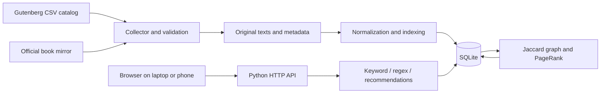

# Algorithm and architecture notes

These describe the implemented choices. Lecture 1 was checked from the supplied
course folder, and Lecture 3 was obtained from the professor's official course
page. The graph follows its occurrence-count formula and strict threshold.

## Architecture

Offline work: collection, index creation, graph construction and centrality.
Online work: vocabulary matching, postings aggregation, result sorting,
recommendation lookup and pagination.

## Text and inverted index

Normalize to NFC and case-fold, normalize curly apostrophes, then tokenize Unicode
letter sequences with optional internal apostrophes. Digits and underscores are
not indexed. No stemming and no stopword removal are performed. This preserves
exact normalized word search and keeps the Jaccard definition transparent.
Book length is the number of these tokens, not file size or vocabulary size.
Line endings are normalized to LF before hashing. Saved source text retains its
Gutenberg wrapper; legacy Windows CRCRLF files are repaired during collection.

`terms(id, word)` provides a unique dictionary. `postings(term_id, book_id, count)`
records occurrences. For example, "sea sea ocean" creates sea→2 and ocean→1.
SQLite B-tree indexes support term and postings lookup. Import is atomic per book.
Bulk preparation uses atomic batches of 25 books, a shared vocabulary-ID map,
and sorted postings inserts. It uses a page cache capped at 512 MiB and WAL with
NORMAL synchronization; this generated index can be resumed after interruption.
Collecting all counts takes O(T) expected time for T tokens, excluding database
insertion costs. Posting storage is proportional to distinct term/book pairs.

Keyword search retrieves one normalized word; it does not scan whole books. Regex
search matches the vocabulary once and sums postings for the matching terms.
Summing counts means a query `sea|ocean` ranks frequency using both words together.

## Regex: Thompson NFA

Recursive descent parses union, concatenation and quantifiers. The compiler
creates character, wildcard, class, epsilon-split and accepting states. Fragments
carry unresolved transitions, which are patched during concatenation and closure.

The matcher computes an epsilon closure, consumes a character by following all
matching transitions, and closes again. Acceptance requires an accepting state
after the **entire indexed word** has been consumed. Cycles in epsilon transitions
are tracked with a visited set. No exponential backtracking is used.

For m states and a word of length L: O(mL) time and O(m) active-state memory.
The matcher reuses up to 16,384 state-set/character transitions across words.
For a finite initial-character set of at most eight characters, search uses
SQLite word-index ranges to filter candidates, then runs the NFA on every
candidate. Epsilon alternatives are handled explicitly. Wildcards, negated
classes, and larger initial alphabets retain the full-vocabulary scan. This
changes the amount of work while preserving whole-word matching semantics.
Vocabulary search costs O(m times the total characters in the vocabulary), plus
postings aggregation. Expressions are limited to 128 characters. A query has an
eight-second vocabulary-scan budget checked between words; this is not a hard
real-time deadline. HTTP search concurrency is limited to two active requests.

Supported: literals, `.`, `|`, grouping, `*`, `+`, `?`, classes/ranges/negation,
escaped punctuation. Unsupported syntax is rejected instead of silently claiming
full Python/PCRE compatibility. The NFA tests compare supported expressions with
Python `re.fullmatch` over an exhaustive small word set, and exercise a nested
quantifier that causes pathological behavior in backtracking engines.

## Jaccard graph

The [official Lecture 3](https://perso.lip6.fr/binh-minh.bui-xuan/files/daar2026/daar3.pdf),
pages 10–12, uses weighted index-table entries `(word, occurrence count)`. Its
displayed sums range over words shared by both documents. For shared words C:

`minimum = sum(min(count_A(w), count_B(w)) for w in C)`

`maximum = sum(max(count_A(w), count_B(w)) for w in C)`

`distance = (maximum - minimum) / maximum`; `similarity = minimum / maximum`.

An edge exists when distance is **strictly less** than the distance threshold.
The default distance threshold is 0.50, equivalently similarity **greater than**
0.50. CLI `--threshold` denotes this similarity cutoff. For no shared words the
slide's fraction has a zero denominator; the implementation explicitly assigns
distance 1 (similarity 0), preventing a link. This is a documented convention.

This follows the slide's shared-word domain literally, rather than ordinary set
Jaccard or a weighted union with absent words assigned zero. Consequently, words
unique to one document do not contribute: different vocabularies can have zero
distance if all shared counts agree. Discuss that limitation and the influence
of book length/common words in the report; do not silently replace the formula.

Exact integer bit planes accelerate the computation. Plane i marks vocabulary
positions whose occurrence count has bit i set. Compare count planes from the
most significant bit to identify which document has the smaller count at each
shared word, select min/max planes, then sum their bit counts weighted by 2^i.
This computes the same integer sums as a direct per-word loop. Tests verify 225
document pairs against independent count sums, including sparse positions,
disjoint vocabularies, empty vectors, and large counts.

For N books, vocabulary ID span V, maximum count bit depth b, and machine word
width w, comparison is approximately O(N² bV/w) word operations; vector storage
is bounded by O(NbV/w), with leading zero regions omitted in Python integers.
Edges can occupy O(N²). Counts are retained exactly; there is no approximate
top-term sketch or stopword removal.

Hand fixture: A={sea:2,ocean:1,adventure:1}, B={sea:1,ocean:1,voyage:1},
C={ocean:1,voyage:1,ship:1}, D={forest:1,tree:1,green:1}.
A/B have minimum 2 and maximum 3, so distance 1/3. A/C and B/C have distance 0.
D has distance 1 to the others. At distance cutoff .10 (similarity > .90), the
graph is A—C—B plus isolated D; these exact edges are tested. A separate test
excludes an edge at distance exactly .50 when the cutoff is .50.

The prior set-based graph and measurements are archived under
`reports/set-jaccard-results/` as historical comparison, not the final graph.

## PageRank

The graph is undirected and **unweighted for centrality**; edge similarities are
used for recommendations. With damping alpha=.85 and N nodes:

PR_next(v) = (1-alpha)/N + alpha * dangling_mass/N
             + alpha * sum(PR(u)/degree(u) for u adjacent to v).

Start uniformly at 1/N. Redistribute isolated-node probability uniformly.
Stop when the L1 difference between consecutive vectors is below 1e-10, with
a 200-iteration cap; nonconvergence is reported. One iteration is O(N+E).
Scores sum to approximately 1, including disconnected graphs.

In a three-node star without isolates, the center score is .9/1.85 ≈ .486486;
each leaf has ≈ .256757. The test verifies this independently derived solution.
The report must additionally show examples using actual corpus books.

Search sorts matching books by decreasing global PageRank, then occurrence count,
then ID for deterministic ties. The alternative frequency view reverses the first
two criteria. A central book is not necessarily the most semantically relevant:
this is a hypothesis to evaluate, not a claim of perfect ranking.

## Recommendations

Take the three highest-ranked matching books and traverse their graph neighbors.
Exclude every book matching the original query. For each candidate retain its
largest Jaccard similarity to these three seeds. Return up to six candidates,
sorted by similarity and then ID. No click tracking or personal data is required.

Broad queries can match the entire corpus and legitimately yield no recommendations.

## References to consult and cite

- Course lectures 1 and 3: primary source for the assignment's formal definitions.
- Lecture 3, weighted index-table distance and strict threshold, pages 10–12:
  https://perso.lip6.fr/binh-minh.bui-xuan/files/daar2026/daar3.pdf
- Ken Thompson, "Programming Techniques: Regular Expression Search Algorithm",
  Communications of the ACM, 11(6), 1968, pp. 419–422.
- Lawrence Page, Sergey Brin, Rajeev Motwani, Terry Winograd, "The PageRank Citation
  Ranking: Bringing Order to the Web", Stanford technical report, 1999.
- Project Gutenberg catalog: https://www.gutenberg.org/ebooks/offline_catalogs.html
- Download guidance: https://www.gutenberg.org/policy/robot_access.html

Read the references and verify bibliographic details before using them in the final
report. This file explains the code; it is not the required literature review.
